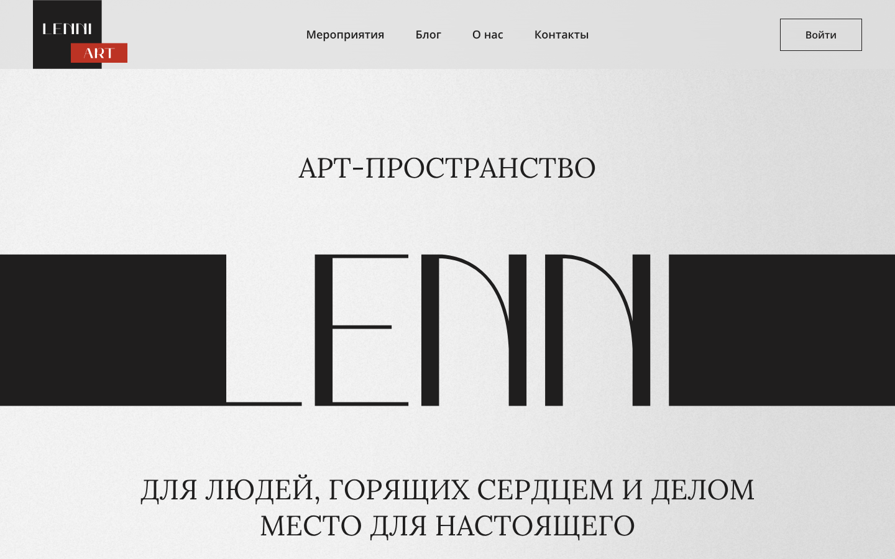

# Lenni Art — сайт арт-пространства

Многостраничный сайт арт-пространства на Nuxt 4: главная с блоками (о пространстве, предложения, ближайшие события, блог, контакты), афиша событий, страница события с формой бронирования.



## Что реализовано
- Главная страница из секций-компонентов (`AppHero`, `AppAbout`, `AppOffers`, `AppUpcoming`, `AppContacts` и др.)
- Афиша: список событий и динамическая страница `/events/[event]`
- Формы с валидацией на русском (VeeValidate), маски ввода (Maska), выбор даты (Air Datepicker)
- Слайдер (Swiper), интерактивная карта (OpenLayers)
- Модальные окна, библиотека полей формы (input, select, radio, checkbox, textarea)
- Данные событий и блога лежат в `public/json`
- Состояние: Pinia · стили: Less с миксинами · SVG как компоненты

## Стек
Nuxt 4 · Vue 3 · Pinia · VeeValidate · Swiper · OpenLayers · Less

## Запуск
```bash
npm install
npm run dev        # http://localhost:3000
npm run build      # серверная сборка
npm run generate   # статическая сборка
```

## Структура
```
app/
├── components/   app/ (секции), event/, field/, page/, the/
├── pages/        index, events, events/[event]
├── stores/       Pinia
├── plugins/      карта, маски, валидация
└── styles/       переменные, миксины, блоки
public/json/      данные событий и блога
```


